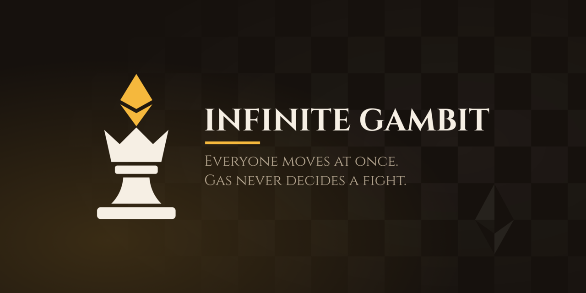

# Infinite Gambit



**Simultaneous chess on an infinite onchain board. Stake an army, capture kings, betray your allies.**

Built at ETHGlobal Mumbai 2026.

- Live demo: https://infinite-gambit.netlify.app/ (Sepolia)
- Demo video: [TODO]
- Contracts: Sepolia, see [Deployed contracts](#deployed-contracts)

## What it is

Infinite Gambit is chess rebuilt for a persistent, permissionless world. Anyone can stake ETH to deploy an army (a king and nineteen pieces) at a spawn point they choose in secret. Every cycle, every army moves up to three of its pieces, committed as a hash and then revealed together, and all moves resolve simultaneously against the board as it was at the start of the cycle.

Staked two-player chess does not work onchain, because engines beat humans and nobody stakes against them. With unbounded players and hidden simultaneous moves, the game becomes social as well as tactical: armies can ally against a third, but nothing forces them to keep the promise, so every cycle is a small prisoner's dilemma.

## The rules in one minute

- **Deploy.** Stake ETH to place an army at a hidden spawn point. An army is a 5 by 5 square without its corners: a king in the centre, a core of seven pieces and twelve pawns that step one square in any direction and capture on any diagonal. Spawn points are 9 apart. Two deployments on the same spawn point in the same cycle both fail and are refunded.
- **One move per army per cycle, of up to three pieces.** A move is up to three piece-moves, each by a different piece, and they count as simultaneous: each is judged against the board as the cycle started, with your own moving pieces counted as gone, so the order you list them in changes nothing. Commit the move as a hash, then reveal it. This is what stops a lone attacker from chasing a king forever: the king steps away while another of its pieces lands on the square it left, and the attacker dies there with it.
- **Simultaneous resolution.** A piece that moves away dodges the capture aimed at it. Two pieces that swap squares both complete their moves. Two or more pieces arriving on one square all die, while a single arriver takes a piece that stayed put. A moving king survives a crowd, but not a lone attacker.
- **No checkmate.** You have to actually capture a king. When you do, you take its whole stake, its army leaves the board, and the piece that took it becomes a queen. If the captor's own king falls in the same cycle, the taken king becomes a **stone**: it holds its stake, never moves, and whoever captures it next takes the stake.
- **Exits.** The only way to take a stake home is to bring your king, alone, to an exit square (the 2 by 2 block where four armies meet diagonally). It pays the stake of every king you took, in ETH.
- **Miss a reveal and your army freezes.** It never moves again, and its stake stays on the board as prey.

The same rules also run as **tables** (closed games for a fixed set of players, with a winner, where the creator may turn three piece-moves off) and **offline**: a whole world on a chain inside the browser tab, for hotseat play at one device and for single player against machine-played seats.

The vocabulary is defined in [`CONTEXT.md`](CONTEXT.md) and the full rule set is in [`work/specs/tasked/infinite-chess.md`](work/specs/tasked/infinite-chess.md).

## How it works

**Reveal order never decides anything.** Reveals land onchain in any order, so a reveal only records facts that do not depend on that order: each origin's destination, a per-destination arrival count, the lone arriver, whether a king arrived. A square's state is a pure function of those facts and its previous state, computed lazily the next time anything touches it. There is no settlement transaction that someone has to pay for each cycle. King captures resolve the same way: a captured army's pieces leave the board lazily, read like an exited army's, and a capture whose captor falls in the same cycle (A takes B while C takes A) leaves a stone, decided one level deep, never by walking a ring. We first built merges (a captured army joining its captor through "captured into" pointers) and dropped them: following those pointers set the worst-case reveal at 1.3M gas, which priced every player's moves.

**One copy of the rules.** Move legality, resolution and the bot's scoring exist only as the contract's `pure` functions. The frontend never re-implements them: it runs the contract's own code in [webevm](https://github.com/wighawag/webevm), an EVM inside the browser tab, so client and chain cannot disagree. The same in-browser EVM can host a whole world, which is how offline play works.

**Stack.**

- Solidity contracts, built with Hardhat v3 and deployed with hardhat-deploy v2 / rocketh. They are route contracts (commit, reveal, getters, simulation, registry) over shared storage, on top of a generic commit-reveal base.
- A SvelteKit 5 / Svelte 5 frontend that draws the infinite board as an animated wooden board with [pixi.js](https://pixijs.com/) (moves slide, captured pieces burn, the stake flies to the captor), with a camera that follows your army and a minimap of the spawn spiral. A plain canvas-2d renderer is kept as a fallback (`PUBLIC_RENDERER`, see `web/.env`). It uses viem for the chain.
- The frontend is a static, IPFS-compatible PWA.
- [fuzd](https://github.com/wighawag/fuzd) is an optional time-locked reveal service, so you don't have to keep the tab open.

Every non-obvious decision is written down as an ADR in [`docs/adr/`](docs/adr/). Start with 0002 (order-free lazy resolution), 0003 (the collision table), 0007 (the rules live only in the contract), 0013 (no merges: a captured army vanishes and its captor is promoted), 0014 (stones), 0015 (the square army on a 9 grid) and 0016 (up to three piece-moves). ADRs 0004, 0009 and 0010 record the merge design that 0013 and 0014 replaced.

## CROPS

- **C (censorship resistant):** The frontend is static and runs from IPFS or any static host. With no RPC configured, it reads the chain through the user's own wallet. Our optional reveal service (fuzd) is a convenience: if it goes away, the open tab reveals for you, and the only cost is that you must keep it open until your reveal lands. The offline world needs nothing from us at all.
- **O (open source):** AGPL-3.0 (see [`LICENSE`](LICENSE)). The contracts, the frontend, the deploy scripts and the in-browser chain can all be built and run from this repo alone.
- **P (private):** No analytics or trackers. Moves stay hidden until the reveal phase, which is the point of commit-reveal. What still leaks: the RPC provider (yours, or the wallet's) sees your address and which board region you read, so it could infer roughly where your army is.
- **S (secure):** Keys stay in your wallet or on your device. The secret for each commitment is kept in your browser's storage until it is revealed. The rules exist only in the contract, so the client cannot disagree with the chain about a move. Trust assumptions: the chain, and the contracts as deployed. The hackathon deployment is still behind an upgradeable proxy, and it becomes immutable once the proxy is dropped or its admin renounced.

## What is new and what is reused

- **Reused:** our own public, generic starter kit, [template-commit-reveal](https://github.com/wighawag/template-commit-reveal). Everything up to commit `6466641` ("template: github:wighawag/template-commit-reveal@5c8b2d8", 5 Nov 2026, 15:56 UTC) comes from it. It provides the commit-reveal cycle machinery, the lobby and table factory, the stake token and sale, an infinite board and canvas, the in-browser chain, hotseat, and the wallet and transaction plumbing. Its developer documentation is kept in [`README.template.md`](README.template.md).
- **New at ETHGlobal Mumbai:** everything after that commit. That covers:
  - the infinite-chess, lean-rules and three-piece-moves specs, and ADRs 0001 to 0016;
  - the chess rules contract ([`contracts/src/game/internal/ChessRules.sol`](contracts/src/game/internal/ChessRules.sol)) and board resolution;
  - army deployment, the square army on a 9 grid, spawn collisions and refunds;
  - up to three simultaneous piece-moves per army, simultaneous resolution and the collision table;
  - king capture with promotion to a queen, and stones (merges were built first, then replaced);
  - freezing, exits and redeeming, and tables (with the toggle that turns three piece-moves off);
  - the greedy bot, the camera and minimap, the HUD and the chess UI;
  - the wooden pixi board and its animations;
  - the offline world running its chain in a Worker;
  - the brand, the landing page, IPFS pinning in CI and the Sepolia deployment.

  Each was merged as its own PR.

## How AI was used

We worked spec-driven with AI agents, all running Claude Opus 5.5. A human (Ronan) wrote and decided the game spec and every ADR. An autonomous runner drove Claude Code agents to implement each task on its own isolated branch, and a task was merged only when the test suite was green. When an agent hit an ambiguity, it stopped and asked the human, who answered in writing. Every spec, ADR, task, question and answer is in this repo under [`work/`](work/) and [`docs/adr/`](docs/adr/), so the split between human and AI work can be audited. The same model also produced the game's look (sprites, UI styling, the brand) under human direction.

## Run it locally

You need [Node.js](https://nodejs.org/) and [pnpm](https://pnpm.io/).

```bash
pnpm i
pnpm start        # local chain, contract auto-deploy and the web dev server, in Zellij
```

Without Zellij:

```bash
pnpm contracts:node:local                       # terminal 1
pnpm contracts:deploy localhost --skip-prompts  # terminal 2
pnpm contracts:export localhost --ts ../web/src/lib/deployments.ts
pnpm web:dev
```

To play with no chain at all, open the **Offline** entry of the menu: the whole world runs inside the tab.

Run the tests:

```bash
pnpm contracts:test
pnpm --filter ./web test:unit
```

Deploy to a network (Sepolia here), with `ETH_NODE_URI_sepolia` and the deployer key set in `contracts/.env.local`:

```bash
pnpm contracts:deploy sepolia
pnpm build sepolia                              # exports the deployment, then builds web/build
pnpm web:serve                                  # serves the build the way an IPFS gateway would
```

More detail on the tooling (deploy scripts, environment variables, development modes) is in [`README.template.md`](README.template.md).

## Deployed contracts

Sepolia (chain id 11155111). Every address and ABI is in [`contracts/deployments/sepolia/`](contracts/deployments/sepolia/).

| Contract                | Address                                                                                                                         |
| ----------------------- | ------------------------------------------------------------------------------------------------------------------------------- |
| Game (the world, proxy) | [`0xDD317B9461E47C0145a419cD5ee0669F9f57A7c3`](https://sepolia.etherscan.io/address/0xDD317B9461E47C0145a419cD5ee0669F9f57A7c3) |
| GameFactory (tables)    | [`0x18985e261c56b9b408a810a89e3fEa649A8Bd340`](https://sepolia.etherscan.io/address/0x18985e261c56b9b408a810a89e3fEa649A8Bd340) |
| GameLobbyImplementation | [`0x4F4A6f405e311a6918fD4a661C3847f454AE494e`](https://sepolia.etherscan.io/address/0x4F4A6f405e311a6918fD4a661C3847f454AE494e) |
| GameToken (the stake)   | [`0x4420a6B2B919350faf478b7eD5dC0f0a72abE075`](https://sepolia.etherscan.io/address/0x4420a6B2B919350faf478b7eD5dC0f0a72abE075) |
| StakeSale               | [`0x1B70f604cBa6F342D4aEf7F36e88557F8e791428`](https://sepolia.etherscan.io/address/0x1B70f604cBa6F342D4aEf7F36e88557F8e791428) |

## License

[AGPL-3.0-only](LICENSE). Some Solidity interface files are MIT, as marked in their SPDX headers.
