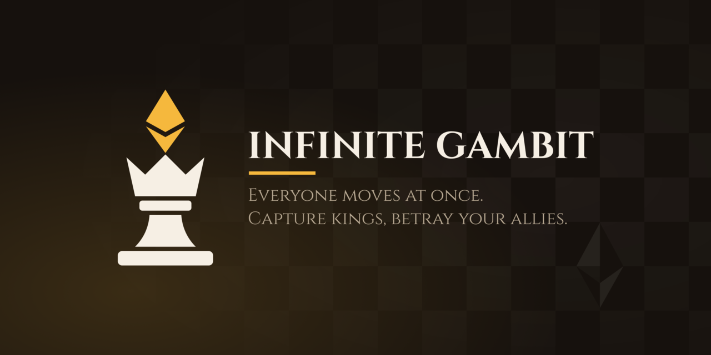

# Infinite Gambit brand

The mark is the **Prism King**: a crowned chess king whose cross is replaced by the Ethereum prism, the king from the Devcon wooden set. In the game the king holds the stake, so the piece that carries the money is the one that wears Ethereum.

## Files

| File | Authored or generated | What it is |
|---|---|---|
| `logo.svg` | authored | The full mark. Ink is `currentColor` (default `#1b1410`), the prism is the accent. No background. |
| `icon.svg` | authored | The simplified mark (crown and prism only) on an opaque walnut plate. Favicon, PWA and app icon source. |
| `src/preview.src.svg` | authored | The 1280x640 social card, with live text. |
| `src/lockup.src.svg` | authored | Mark plus wordmark, horizontal, with live text. |
| `preview.svg`, `lockup.svg` | generated | The same, with text converted to outlines so no consumer needs the font. |
| `preview.png` | generated | The card raster: `og:image`, README header, GitHub social preview. |
| `logo-light.svg`, `lockup-light.svg` | generated | Light-ink copies for `` on dark pages (an `` cannot inherit `currentColor`). |
| `icon.png`, `icon-512.png`, `icon-192.png`, `favicon-32.png` | generated | Icon rasters. |
| `fonts/` | vendored | Cinzel (variable, weights 400 to 900) and its OFL licence. |
| `game/` | authored + generated | The in-game visual proposal: piece set and mock scene. See `game/README.md`. |
| `concepts/` | history | Contact sheets and rejected variants. Safe to delete once the brand is settled. |

Run `./build.sh` (on NixOS: `nix shell nixpkgs#inkscape -c ./build.sh`) to regenerate everything, including the copies in `landing/brand/` and `landing/fonts/`. Two runs give byte-identical output. Never hand-edit a generated file.

The build first checks that the prism and the king have the same path data in `logo.svg`, `icon.svg` and both card sources, and fails if they have drifted (tested by nudging one coordinate).

## Decisions that are easy to undo by mistake

- **The accent is `#f5b83d`, opaque.** It's a little deeper than the game's own "your army" gold (`#ffd166`, in `web/src/lib/chess/render/style.ts`), because `#ffd166` is too weak on light backgrounds. Opaque because a translucent gold goes muddy on the walnut plate. One accent, one meaning: the prism (Ethereum, the stake). The rule under the wordmark is the only other gold element, and it belongs to the same lockup.
- **The icon is a different drawing, not a scaled logo.** The base, stem and collar disappear below 32px, so the icon keeps only the crown and the prism, at 1.4x. Don't swap `logo.svg` in as the favicon.
- **Crown points, not a cup.** A flared cup under the prism reads as a torch or a trophy (see `concepts/r1`). The three crown points are what make it a king.
- **The wordmark is Cinzel 700, solved to an ink width of 620px on the card** (67.7px nominal) and outlined. The tagline is Cinzel 400 at 32px on two lines, one sentence per line. If you change the copy, re-solve the size against the ink width (see the branding notes in the build script history) rather than eyeballing it.
- **`currentColor` is restored after outlining.** Inkscape resolves it to a hex while converting text to paths, and the build puts it back so one lockup serves light and dark.
- **The card's background**: a checkerboard fading out to the edges (the board has no edges), a gold glow, and the Devcon board's inlay: the Ethereum logo as four triangles, one in each square meeting at (1080, 480), each in the opposite tone to its square (**inverted marquetry**), exactly as on the real board. The landing hero repeats it in the real woods (maple `#e2cba0`, rosewood `#7a4a2c`).

## Directions tried and dropped

- **Unicorn Knight as the logo.** Charming, but a horse head doesn't read at 16px. It lives on as the knight of the piece set (`game/`).
- **Hash Board** (a `#` made of checkered squares). Reads as a hashtag. Its idea (Ethereum across the centre four squares) became the background of the card and the landing page.
- Round 1 (`concepts/r1`): prism over a cup (torch), prism as the head (trophy), prism in a hexagon (generic crypto badge).
- Round 2 (`concepts/r2`): the gem set into a V crown (turns to mush at 16px), a flat-topped cup (torch again).

## Known gaps

- "Infinite Gambit" is also the name of an unrelated chess roguelike announced on Steam (app 5316750). We kept the name knowingly.
- No light-background version of the card. Add `preview-light.png` if a light README theme ever needs one.
- The app itself is not rebranded: `web/static/icon.svg`, `web/static/preview.png` and `web/src/web-config.json` still carry the template's identity. Switching them over is a one-line copy per file, left for a separate change.
