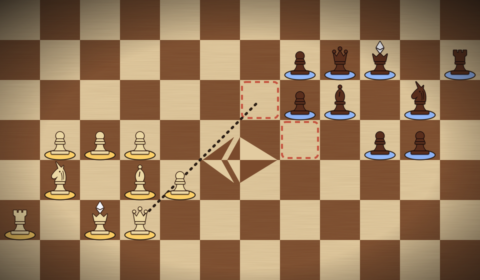

# A visual proposal for the board

**Status: proposal only.** Nothing in `web/` is changed by this folder. It shows what the game could look like, and how each change maps onto the current renderer, so it can be picked up as tasks.

The mock is built from the real piece set below (`./build.sh` regenerates it). It shows your army in boxwood with gold rims (bottom left), another army in sheesham with blue rims (top right), a planned queen move, two attacked squares, and the Ethereum inlay at the centre of the world.

## Where it comes from

The Devcon swag board (photographed at the event):

- **Woods.** Maple light squares and reddish rosewood dark squares, in a darker rosewood frame with a thin maple stripe. The pieces are turned Staunton shapes in pale boxwood against dark sheesham.
- **Unicorn knights**, with a carved mane. The king has a pointed, faceted finial: the prism.
- **The inlay is the Ethereum logo lying on its side** (large facet pointing right, chevron pointing left) across the four centre squares, in **inverted marquetry**: maple where it crosses a rosewood square, rosewood where it crosses a maple one.

The mock uses colours sampled from those photos. The pieces share the logo's construction (one base, stem and collar for the whole set, only the top changes), so the game and the brand read as one thing.

## Today

`web/src/lib/chess/render/board.ts` draws a dark board (light squares are 5% white over the background), and `render/style.ts` draws each piece as a Unicode chess glyph (`\u265A` and friends) tinted by an army colour from a hash of the army id, with your army in `#ffd166`. That's clear and cheap, but glyphs depend on the device's fonts, they look different on every OS, and they carry no identity.

## Proposed changes, in order of value per hour

1. **The piece set** (about 2 hours). Replace `glyphOf` with the paths in `pieces.py` (also exported as `pieces/*.svg` and the `pieces.svg` sprite). Canvas 2D takes SVG path strings directly through `new Path2D(d)`, so there's no image loading. Draw each piece in its wood (see 4) with a dark outline (stroke first, then fill), and cache one bitmap per (kind, colour, zoom bucket) in an `OffscreenCanvas` so a crowded viewport costs one `drawImage` per piece. Keep the glyph as the fallback below `MIN_GLYPH_SCALE`, where a dot is enough anyway.
2. **A wooden board** (about 1 hour). Maple `#e2cba0` and rosewood `#7a4a2c` squares instead of the 5% white grid, with a faint grain pattern (`createPattern` from a small noise tile) and a vignette at the screen edges. Highlights stay as they are, but the planned-move green and the collision red need checking for contrast on maple.
3. **The Ethereum inlay at the centre of the world** (about 30 minutes). Squares are centred on integer coordinates, so the four squares (-1,-1), (0,-1), (-1,0) and (0,0) meet at the point (-0.5,-0.5). Draw the logo there on its side, under the pieces, twice: once in maple clipped to the two rosewood squares and once in rosewood clipped to the two maple squares. That's the inverted marquetry of the Devcon board, and `pieces.py` does exactly this for the mock. On an infinite board it gives everyone a landmark, and the minimap can show it too.
4. **Boxwood for you, sheesham for everyone else, army colour on the rim** (30 minutes). The question a player asks most is "is that mine?", and two woods answer it at a glance, exactly as on the real board. Which other army a piece belongs to is then a coloured ellipse under its base, which stays readable even when two army hues are close.
5. **Kings that show their stake** (1 to 2 hours). The prism is crystal white on every king. Scale its size, or add a glow, with the stake the king holds (`_stakeOf`, which grows with every merge). A rich empire is then visible at a glance as a target. That's gameplay information, not decoration.
6. **States that read as states** (1 to 2 hours).
   - *Committed*: a small wax seal with a `#` on the king of an army that has committed this cycle. It shows that a move exists without showing what it is.
   - *Frozen*: desaturate the whole army and tint it ice blue.
   - *Exit squares*: gold-inlaid squares, the one other gold thing on the board, because they're where the stake leaves.
   - *Spawn points*: keep the ring, drawn as a marquetry border rather than a plain outline.
7. **Resolution animation** (half a day, later). All moves of a cycle slide at the same time (it's the core idea, so show it). Collisions get a short burst on the square, and on a king capture the absorbed army's colour ripples into the captor's.

Items 1 to 4 are presentation only: no rule of the game is touched (ADR 0007 keeps the rules in the contract, and `render/` already "decides nothing"). Items 5 and 6 read state the view already has or can get from existing getters.

## Accessibility

Keep shape as the primary cue and colour as the second one: every kind has a distinct silhouette, and the base ellipse plus outline keep two similar hues apart. For colour-blind players, consider a pattern or a letter on the base as an option.

## Files

- `pieces.py`: the source of truth for the piece paths. It writes `pieces/*.svg`, `pieces.svg` and `scene.svg`.
- `build.sh`: regenerates everything and renders `scene.png` and `pieces.png` (rsvg, because Inkscape drops the scene's shadowed groups).
