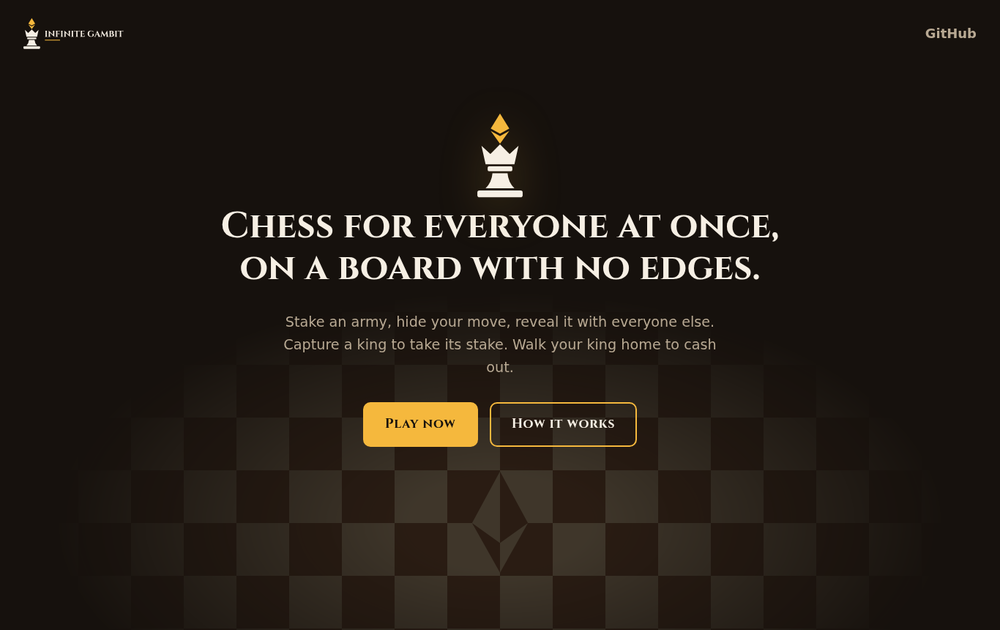

# Landing page

A single static page for Infinite Gambit: no build step, no framework, no third-party requests. The font is self-hosted (`fonts/`) and every asset is local, so the folder deploys as-is to IPFS or any static host, and it keeps the CROPS promise of no trackers.

- `index.html`, `style.css`: authored.
- `brand/`, `fonts/`: copied in by `assets/brand/build.sh`. Don't edit them here.

Preview it with `python3 -m http.server -d landing 8124`, or open `landing/index.html` directly.

## Before it goes live

- The "Play now", "Enter the world" and "Play offline" buttons point at `#`. Set them to the deployed app (and its offline or hotseat route).
- `og:image` is a relative path. Some crawlers need an absolute URL, so set it to the final host.
- The exits line ("Walk your king home to cash out") assumes exits ship.
