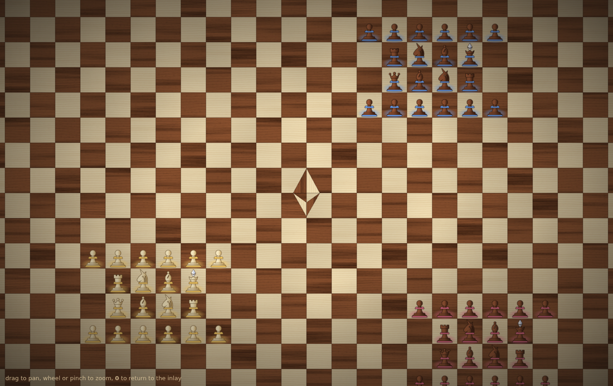
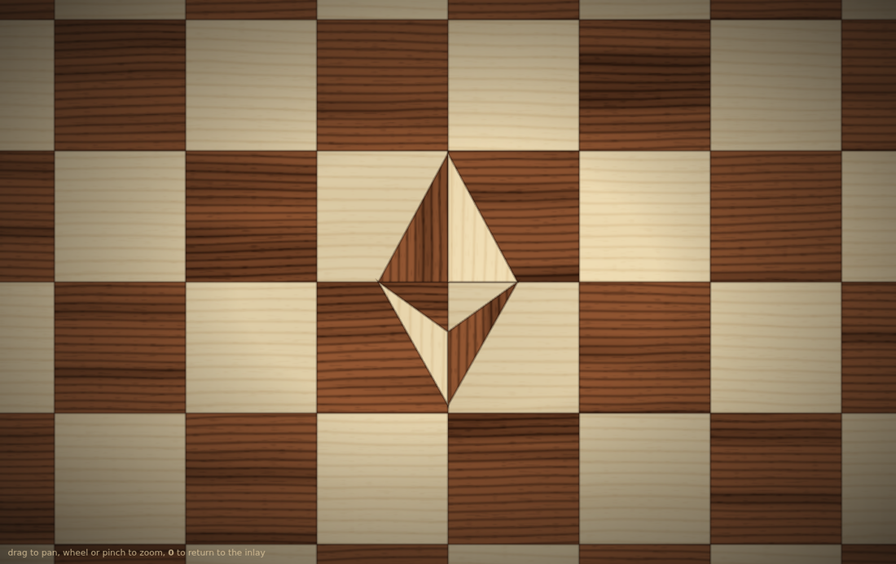
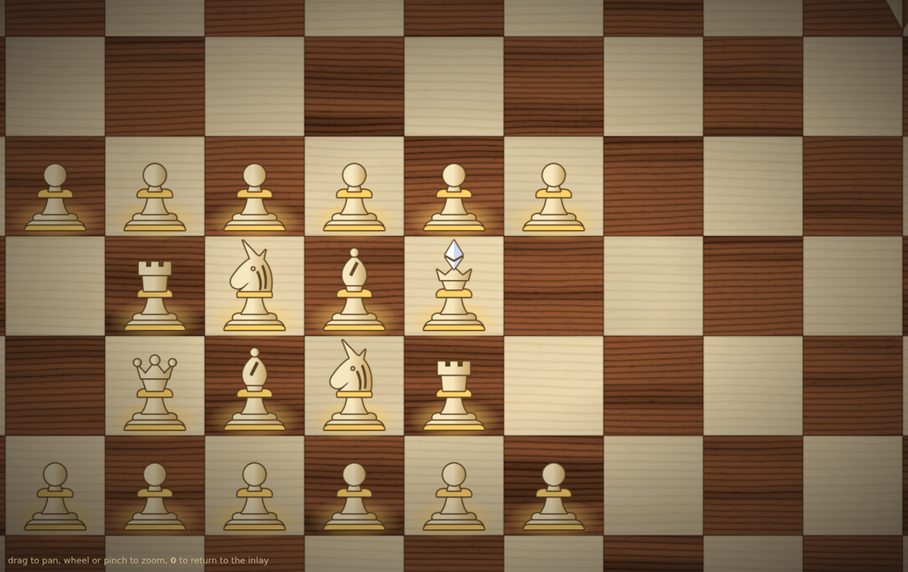

# Spike: the Devcon wooden board on pixi.js

**Status: spike.** It answers one question: can the game look like the Devcon swag board (maple and rosewood squares, the Ethereum marquetry inlay, turned boxwood and sheesham pieces with unicorn knights) on an infinite board, in pixi, cheaply enough to keep? Yes. Nothing in `web/` uses it yet; this README says how it would.







## Run it

It is its own workspace root (see `pnpm-workspace.yaml`), not a member of the repo's, so installing it never touches the root lockfile or the app.

```sh
cd spikes/pixi-wood-board
pnpm install --ignore-workspace
pnpm dev            # drag to pan, wheel or pinch to zoom, 0 to return to the inlay
pnpm build          # type-checks too
```

`?x=&y=&scale=` sets the camera (in squares, and pixels per square), which is how the screenshots were taken.

## What's in it

| File | What it does | Fate in the game |
|---|---|---|
| `src/wood.ts` | Procedural wood: growth rings bent by noise, long streaks, short pores, generated once on a canvas per species (maple, rosewood). Deterministic, no download, no shader, well under 100 ms. | **Keep as is.** Pure, no pixi import. |
| `src/board.ts` | The infinite board: a pool of square sprites relaid on every view change, each sampling one of 24 windows of its wood (some mirrored, each a slightly different tone, like separate pieces of veneer), thin joins between squares, and the inlay. | **Keep.** It's the board layer of a pixi renderer. |
| `src/pieces.ts` | Pieces rasterised once per (kind, wood, army colour) from the shared path data into mipmapped textures, plus the army glow. | **Keep the textures**; the `PieceLayer` is spike-sized and becomes the reconciler's handlers (below). |
| `src/camera.ts` | Pan, zoom and the transform. | **Drop**, except `visibleCells`: the game's host already owns input and `applyTransform` (`web/src/lib/game/render/pixi/world.ts`), with the same contract this file copies. |
| `src/main.ts` | The harness: app, armies, vignette. | **Drop.** |
| `src/pieces.json` | Piece paths, part roles, woods and the inlay triangles. | Copied from `assets/brand/game/pieces.json` (written by `pieces.py`): `pnpm sync`. |

### Decisions worth keeping

- **Each square samples a window of one shared texture**, rather than each square having its own texture or the board being one tiled texture. All squares batch into a few draw calls because they share two texture sources, yet no two neighbours look cut from the same piece. A single tiled texture would repeat visibly on an infinite board.
- **The inlay is wood, masked**, not a flat fill: each of the four triangles is a sprite of the opposite wood with its grain turned 90 degrees, masked by the triangle. That's what makes it read as marquetry rather than a sticker. It's at the corner where squares (-1,-1), (0,-1), (-1,0) and (0,0) meet, which is (-0.5, -0.5) because squares are centred on integer coordinates, as in the game.
- **Pieces are raster, from SVG, once.** A piece's look (wood gradient, outline, band, crystal) is defined by the same SVG as the brand mock, so the two cannot drift. One sprite per piece at any zoom, with mipmaps for zoomed-out views.
- **Pieces stand on the lower part of their square** (anchor at the foot) and sort by row, so a tall piece rises into the square above and overlaps correctly, as a real piece seen slightly from the side.

### Measured

- Wood generation: two 512 x 512 textures at start-up, imperceptible.
- At the minimum zoom (14 px per square) on a 1366 x 860 screen, the board pool is about 6,600 sprites (101 x 65 squares), which pixi batches without effort. Below that, the right move is to stop drawing grain and draw flat squares, which the spike doesn't do.

## How it goes into the game

The chess game draws with the **immediate canvas-2d** renderer today (`web/src/lib/chess/render/index.ts` says why: a few glyphs per square, nothing animated). The template's pixi host is already in the tree (`web/src/lib/game/render/pixi/`), with the **stateful** renderer and its reconciler (`web/src/lib/game/render/stateful.ts`, `reconcile.ts`). The path:

1. Move `wood.ts`, `board.ts` and the texture half of `pieces.ts` to `web/src/lib/chess/render/pixi/`. `pieces.json` moves with them (or is imported from `assets/brand/game/`).
2. Write `createChessPixiRenderer` with `createStatefulRenderer`:
   - The **board** is not an entity: call `board.update(visibleCells(transform, screen))` from the renderer's `tick`, so it follows the camera every frame.
   - **Pieces** are the entities, keyed by square (or piece id). `add` creates the glow and the sprite from `PieceTextures` (wood = mine or not, band = `armyColour(army)` from `render/style.ts`), `update` moves or re-textures them, `remove` destroys them.
   - Highlights (selected, destinations, planned move, collisions, captures) are a third layer, also from the view state, drawn over the board and under the pieces.
3. Switch `web/src/lib/chess/render/index.ts` to the pixi host and set `smooth: true` on the surface (`pixi/surface.ts`), since this art is smooth, not pixel art.
4. Keep the canvas-2d renderer as the low-zoom fallback, or add flat squares below ~10 px per square.

Rules are untouched by all of this: like the current renderer, it only draws what the view state says (ADR 0007).

## Not done here

- Highlights, planned moves, spawn rings and the HUD: the existing renderer has them and the move is mechanical.
- The low-zoom fallback.
- Lacquer sheen or lighting: the vignette is the only lighting, and a subtle specular pass on the squares could come later.
