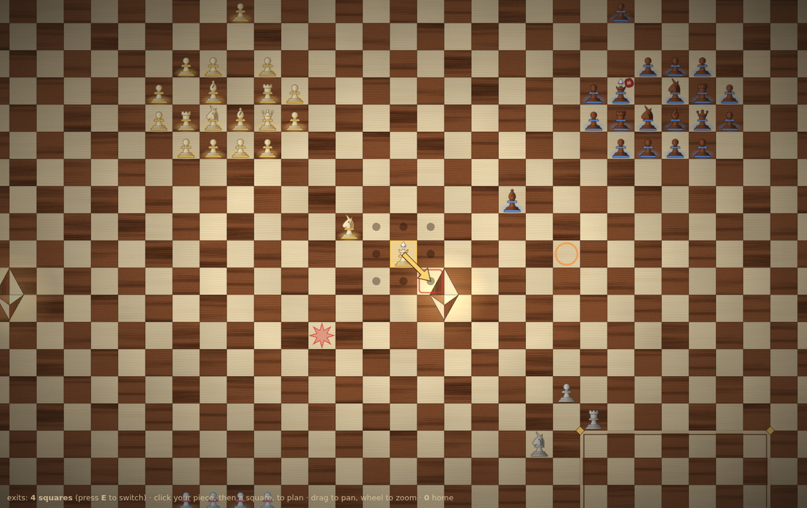
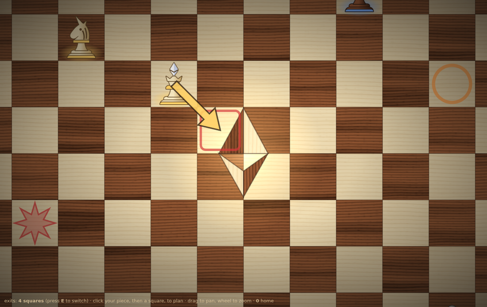
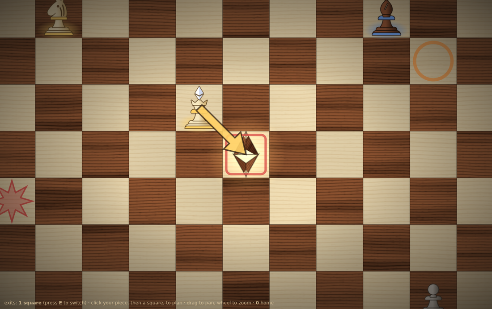
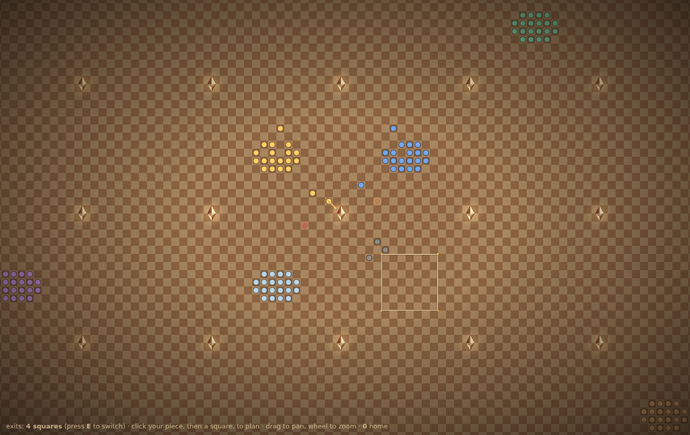
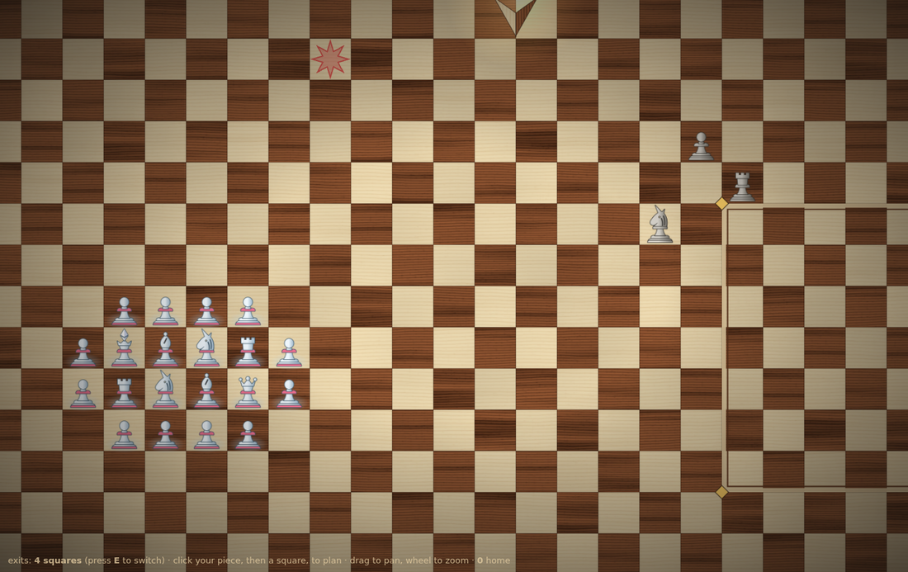

# Spike: the Devcon wooden board on pixi.js

**Status: spike.** It answers one question: can the game look like the Devcon swag board (maple and rosewood squares, the Ethereum marquetry inlay, turned boxwood and sheesham pieces with unicorn knights) on an infinite board, in pixi, cheaply enough to keep, with everything the board has to show? Yes. Nothing in `web/` uses it yet; this README says how it would.



## Exits are the Ethereum inlay

The Ethereum logo now means one thing on the board: **ETH leaves here**. Every exit is the Devcon inlay, and it breathes: a soft gold glow under it and an additive copy of it pulsing slowly, so exits read as places, not decoration, and stay visible as beacons when zoomed out. The world's origin no longer has an inlay of its own, since it's a spawn point and an army stands on it.

Press **E** to compare the two sizes:

| 4 squares (proposed) | 1 square (today's rule) |
|---|---|
|  |  |

**My recommendation is 4 squares.**
- It's the real Devcon inlay (one triangle per square) and readable at every zoom, where the 1-square logo is a smudge.
- One piece can no longer block an exit by sitting on it, so exits are harder to camp.
- A king has four ways in, so reaching an exit is a fight for a region, not a single square.

**It is a rule change, and a small one.** Exits are the centre of each spawn-grid cell today (`UsingGameBoard._isExit`, `web/src/lib/chess/exits.ts`). With 4, the exit is the 2 x 2 block whose shared corner is that centre: on each axis, accept `(v - half) % spacing` of `0` **or** `spacing - 1`. That's two comparisons more in `_isExit`, the same in `isExitSquare` (this spike's `exits.ts` has it), and `exitsIn` returning blocks. Things to settle before changing it:
- Two kings may arrive on two different squares of one block in the same cycle. Each square still follows the collision table, so both exit, unless the king-adjacency rule (story 20) is meant to forbid that. It's validated against the start-of-cycle board, so it doesn't today.
- The exit tests (`contracts/test/js/Exits.test.ts`) and the minimap would need the block form.

## Everything else the board shows



- **Highlights** (`src/overlays.ts`), the same information as today's canvas renderer, restyled:
  - Selection: a gold square.
  - Destinations: a dot on an empty square, corner wedges on a capture.
  - Attacked squares: a red inner border, shown only where it matters (the selection's destinations, around your king, the planned target).
  - The planned move: a gold arrow drawn over the pieces.
  - Last cycle: a red burst where pieces collided, an orange ring where a piece was captured.
  - Open spawn points: a marquetry frame with gold corner diamonds around the 7 x 7 footprint.
- **Piece states** (`src/pieces.ts`):
  - A **rock** (ADR 0011) is the piece in stone, with no band and no glow.
  - A **frozen** army is in ice, keeping its army colour on the band.
  - The king of an army that has **committed** this cycle wears a wax seal with a `#`: it shows a move exists without showing what it is.

  
- **Low zoom** (`FLAT_BELOW` and `DOTS_BELOW`, 18 px per square): the grain and the pieces are invisible at that size anyway, so the board becomes one tiling sprite of a low-contrast checker (a full-contrast one shimmers), pieces become dots in their army colour, and exits shrink to small glowing logos that fade a little as the camera pulls back. That's the map view above. The camera now goes down to 4 px per square.

**The moves in the demo are fake:** a naive generator in `main.ts`, because the spike has no chain. In the game, destinations and attacks come from the contract (ADR 0007).

## Run it

It is its own workspace root (see `pnpm-workspace.yaml`), not a member of the repo's, so installing it never touches the root lockfile or the app.

```sh
cd spikes/pixi-wood-board
pnpm install --ignore-workspace
pnpm dev            # drag to pan, wheel or pinch to zoom, 0 to return to the inlay
pnpm build          # type-checks too
```

Click one of your (boxwood) pieces, then a square, to plan a move. **E** switches the exit size and **0** goes home. `?x=&y=&scale=` sets the camera (in squares, and pixels per square), `?exit=1|4` the exit size and `?select=x,y` a selection, which is how the screenshots were taken.

## What's in it

| File | What it does | Fate in the game |
|---|---|---|
| `src/wood.ts` | Procedural wood: growth rings bent by noise, long streaks, short pores, generated once on a canvas per species (maple, rosewood). Deterministic, no download, no shader, well under 100 ms. | **Keep as is.** Pure, no pixi import. |
| `src/board.ts` | The infinite board: a pool of square sprites relaid on every view change, each sampling one of 24 windows of its wood (some mirrored, each a slightly different tone, like separate pieces of veneer), thin joins between squares, and the flat tiling fallback for low zoom. | **Keep.** It's the board layer of a pixi renderer. |
| `src/exits.ts` | Exits: the inlay baked once into a texture per size, then three sprites per exit (inlay, breathing copy, glow). Also `isExitSquare` and `exitCentres` for both sizes. | **Keep.** Its position maths must match `web/src/lib/chess/exits.ts`. |
| `src/overlays.ts` | Highlights, as two `Graphics` (under and over the pieces), redrawn when the state changes. | **Keep**, fed from the view state's `selected`, `destinations`, `plannedMove`, `outcomes` and `spawnPoints`. |
| `src/pieces.ts` | Pieces rasterised once per (kind, finish, army colour) from the shared path data into mipmapped textures; the army glow; stone, ice and the wax seal; dots for low zoom. | **Keep the textures**; the `PieceLayer` is spike-sized and becomes the reconciler's handlers (below). |
| `src/camera.ts` | Pan, zoom and the transform. | **Drop**, except `visibleCells`: the game's host already owns input and `applyTransform` (`web/src/lib/game/render/pixi/world.ts`), with the same contract this file copies. |
| `src/main.ts` | The harness: app, the scene, click-to-plan with fake moves, vignette. | **Drop.** |
| `src/pieces.json` | Piece paths, part roles, woods and the inlay triangles. | Copied from `assets/brand/game/pieces.json` (written by `pieces.py`): `pnpm sync`. |

### Decisions worth keeping

- **Each square samples a window of one shared texture**, rather than each square having its own texture or the board being one tiled texture. All squares batch into a few draw calls because they share two texture sources, yet no two neighbours look cut from the same piece. A single tiled texture would repeat visibly on an infinite board.
- **The inlay is wood, masked**, not a flat fill: each of the four triangles is a sprite of the opposite wood with its grain turned 90 degrees, masked by the triangle. That's what makes it read as marquetry rather than a sticker. Masks are costly, so it's **baked once into a texture** and every exit reuses it.
- **Pieces are raster, from SVG, once.** A piece's look (wood gradient, outline, band, crystal) is defined by the same SVG as the brand mock, so the two cannot drift. One sprite per piece at any zoom, with mipmaps for zoomed-out views.
- **Pieces stand on the lower part of their square** (anchor at the foot) and sort by row, so a tall piece rises into the square above and overlaps correctly, as a real piece seen slightly from the side.

### Measured

- Wood generation: two 512 x 512 textures at start-up, imperceptible.
- The grained board is only drawn down to 18 px per square: about 4,000 sprites on a 1366 x 860 screen, which pixi batches without effort. Below that it's one tiling sprite, at any zoom.

## How it goes into the game

The chess game draws with the **immediate canvas-2d** renderer today (`web/src/lib/chess/render/index.ts` says why: a few glyphs per square, nothing animated). The template's pixi host is already in the tree (`web/src/lib/game/render/pixi/`), with the **stateful** renderer and its reconciler (`web/src/lib/game/render/stateful.ts`, `reconcile.ts`). The path:

1. Move `wood.ts`, `board.ts` and the texture half of `pieces.ts` to `web/src/lib/chess/render/pixi/`. `pieces.json` moves with them (or is imported from `assets/brand/game/`).
2. Write `createChessPixiRenderer` with `createStatefulRenderer`:
   - The **board** and the **exits** are not entities: call `board.update(...)` and `exits.update(...)` from the renderer's `tick`, so they follow the camera (and the exits breathe) every frame.
   - **Pieces** are the entities, keyed by square (or piece id). `add` creates the glow and the sprite from `PieceTextures` (wood = mine or not, band = `armyColour(army)` from `render/style.ts`), `update` moves or re-textures them, `remove` destroys them.
   - **Highlights** are `Overlays.set(...)` whenever the view state changes.
3. Switch `web/src/lib/chess/render/index.ts` to the pixi host and set `smooth: true` on the surface (`pixi/surface.ts`), since this art is smooth, not pixel art.
4. Mark exits on the minimap with the same small logo.

Rules are untouched by all of this: like the current renderer, it only draws what the view state says (ADR 0007).

## Not done here

- Animation of a cycle's resolution (all moves sliding at once), which is the next thing worth spiking.
- The HUD, which stays Svelte.
- Rocks and ice are close in tone at a glance: ice could get a frost rim, or rocks a darker granite.
- Lacquer sheen or lighting beyond the vignette.
